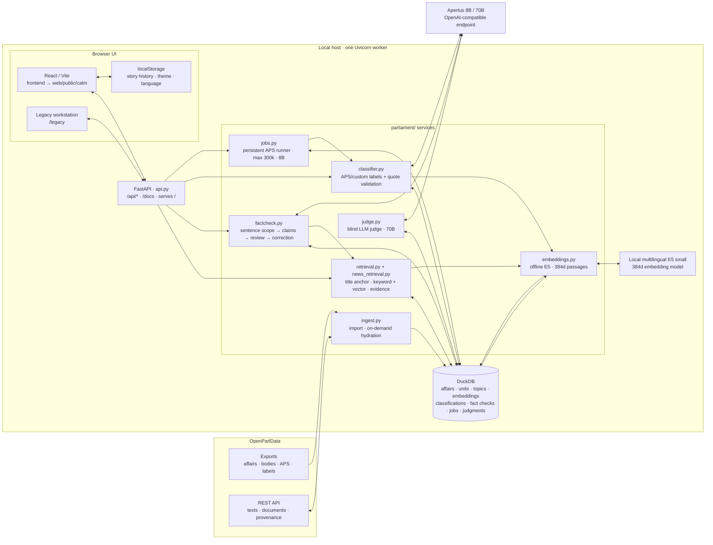

# ParlaRadar

ParlaRadar helps journalists check political claims against Swiss parliamentary records. It also classifies OpenParlData affairs into APS or user-defined topics. Built by team VectorZero.

## Run locally

1. Set up Python and install dependencies:

   ```sh
   python3 -m venv .venv
   source .venv/bin/activate
   pip install -r requirements-embeddings.txt
   ```

2. Put your Apertus/Keera API key in `.key` at the repository root. Keep it private (`chmod 600 .key`).
3. If the local archive is not present, import it once: `python -m parliament bootstrap`.
4. Build the UI after a fresh checkout or frontend change:

   ```sh
   npm --prefix frontend ci
   npm --prefix frontend run build
   ```

5. Start the app with `bash scripts/run_demo.sh` and open <http://127.0.0.1:8000>.

The launcher runs one Uvicorn worker without autoreload. Use it for the full archive; a development `--reload` watcher can consume substantial CPU while watching this repository. The archive classifier and 70B quality judge run in the background by design.

## What it does

- **News fact-checker:** analyzes a multi-sentence story, scopes each sentence, retrieves DuckDB evidence, and shows supported, contradicted, unverified, or apolitical results. Corrections require supporting evidence. Results expose cited affairs, APS topics, authors, and dates when available. English, German, French, Italian, and Romansh are supported.
- **Archive classification:** classifies affairs with Apertus 8B or 70B, APS topics, or approved custom topics. The continuous APS runner handles up to 300,000 affairs and reports progress, rate, and an estimated finish time.
- **Topic map and review:** explore saved digitalisation-to-APS links, inspect evidence, and mark results for human review. The original full workstation remains at `/legacy`; the API is at `/docs`.

## Architecture



One local FastAPI process (`127.0.0.1:8000`) serves both UIs and the API. When the archive is present, startup ensures a resumable APS run covering up to 300,000 affairs with 8B, plus a separate 70B judge; inference calls are serialized by a shared lock. The full table map, endpoint sequence, retrieval limits, and storage/locking details are in [TECHNICAL_REPORT.md](TECHNICAL_REPORT.md).

## Evaluation and limits

The displayed archive quality score measures agreement with a second Apertus 70B judge; it is not human-verified accuracy. The live news regression set is small and curated, not an independent benchmark. Retrieval is bounded: missing evidence means *unverified*, not *false*. Review the original source before publication. See [VALIDATION.md](VALIDATION.md) and [evaluation/BENCHMARK.md](evaluation/BENCHMARK.md).

Run automated checks with:

```sh
python -m unittest discover -s tests
cd web && npm ci && npm test
```

Source code: MIT. Challenge materials and project documentation: CC BY 4.0.
