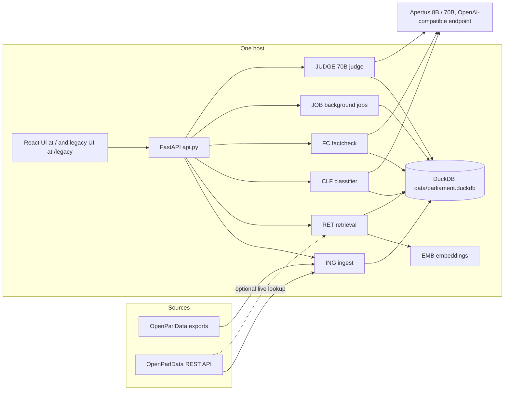
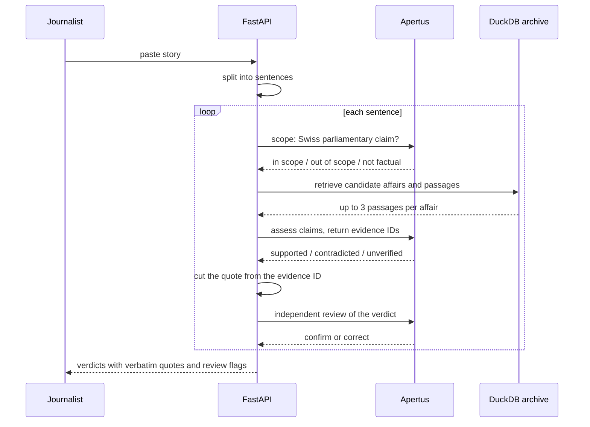
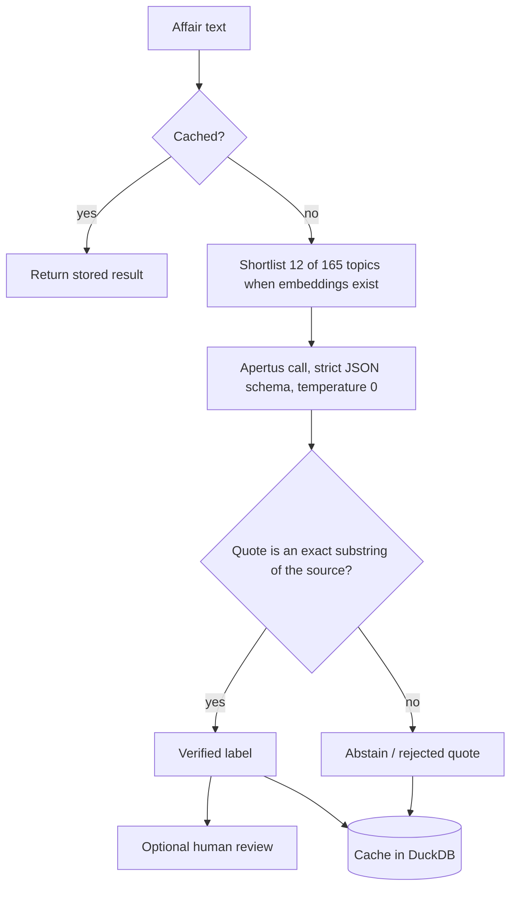

# Hack Apertus Liebefeld — OpenParlData: Topic classification for Swiss parliaments with Apertus, VectorZero

Template repository for [Hack Apertus](https://hackapertus.ch/) submissions.
Every project keeps the same layout, so organizers and judges find the same
things in the same place.

There are 3 challenges to pick from:
1. Bern Economic Development Agency: Research & Expertise Navigator
2. OpenParlData: Topic classification for Swiss parliaments with Apertus
3. University of Bern: Deciphering Archives with Apertus

OpenParlData.ch publishes the affairs (motions, postulates, interpellations, bills) of Swiss federal, cantonal and municipal parliaments in German, French, Italian and Romansh: according to the challenge brief, more than 300,000 affairs and 900,000 documents from about 90 parliaments. Every parliament tags topics in its own way, so affairs cannot be compared across parliaments, and public-sector users such as Digital Administration Switzerland (DVS) cannot find themes like "Digitalisation" that no official scheme contains. The challenge is to use Apertus to classify affairs into the Année Politique Suisse (APS) scheme (165 topics) and into user-defined topics, without retraining, and to make the results explainable and checkable by humans.

Submissions must use the v1.5 Apertus model family.
The submission must comply with the [HackApertus T&C](https://hackapertus.ch/terms-and-conditions).

## 🎯 The Challenge

**OpenParlData: Topic classification for Swiss parliaments with Apertus**

- Notion challenge page: https://app.notion.com/p/hackapertus/OpenParlData-9e3b4fec112a82559ec0011ee5b6f48d?source=copy_link
- Challenge presentation: https://hackapertus-topic-classification-5c233f.gitlab.io/

**Our solution, ParlaRadar.** ParlaRadar does two things with Apertus, always tied to source text. It classifies affairs into the 165 APS topics or into a custom topic such as the DVS "Digitalisation" scope, and every label carries a quotation that is checked as an exact passage of the source (otherwise the system abstains). And it fact-checks news stories sentence by sentence against the parliamentary archive: claims are marked supported, contradicted or unverified, each with a verbatim quote, an independent review and a human-review switch. A missing match is never reported as "false". Try the five multilingual, archive-grounded inputs in [examples.md](examples.md). The evaluation, deployment assessment and limitations are in [technical_report.md](technical_report.md).

### Architecture

ParlaRadar is one FastAPI process (one Uvicorn worker) over one DuckDB file. Apertus is the only mandatory external service. The
deployment options (on-premise, air-gapped, Swiss cloud) are assessed in [technical_report.md](technical_report.md), section 2.



| Component | Module | Role |
| --- | --- | --- |
| ING | `parliament/ingest.py` | Imports affairs, bodies, texts and events from the OpenParlData exports and API |
| RET | `parliament/retrieval.py`, `news_retrieval.py` | Keyword plus vector search, fused with reciprocal-rank fusion |
| EMB | `parliament/embeddings.py` | multilingual-E5-small (384 dimensions) for affair text units |
| CLF | `parliament/classifier.py` | APS / custom-topic classification with verbatim-quote validation |
| FC | `parliament/factcheck.py` | Sentence-by-sentence news fact-check with independent review |
| JOB | `parliament/jobs.py` | Background classification jobs |
| JUDGE | `parliament/judge.py` | Blind Apertus 70B reference judge |

#### Data ingestion and retrieval

- `python -m parliament bootstrap` imports the archive and the 165 APS topics. `bulk-texts` fetches texts for chosen affairs.
- Optional vector search: `python -m parliament fetch --sample 200`, then `export-units`, `embed` and `import-embeddings`
  (embeddings can be computed on a GPU machine and imported). They enable the 165-to-12 topic shortlist.
- Search fuses the keyword and vector rankings by reciprocal-rank fusion, score 1 / (60 + rank).
- News grounding: an exact title anchor, at most 8 candidate affairs, text hydrated for at most 3, at most 3 passages per affair.
  Titles are never evidence.

#### Durable state (DuckDB)

| Group | Tables |
| --- | --- |
| Archive | `affairs`, `bodies`, `units`, `fetches` |
| Taxonomy and search | `topics`, `source_labels`, `embeddings`, `settings` |
| Classification | `classifications`, `reviews` |
| Jobs | `jobs`, `job_items` |
| Judge | `llm_judgments` |
| Fact-check | `fact_checks`, `fact_check_sentences`, `fact_check_translations` |

Fact-check history and review flags are also kept in the browser's `localStorage`, which is not shared between users.

#### Fact-check flow

A story is limited to 40 sentences and 12,000 characters. Each sentence goes through this sequence:



#### Classification flow

A result is cached under the key affair, topic scheme, version, language, content hash, model and prompt version.



## 🔧 Resources & Tools

Check our resources & tools page for detailed information:
[https://hackapertus.notion.site/liebefeld-resources-tools](https://hackapertus.notion.site/liebefeld-resources-tools)

| Models           | URL                                      |
|------------------|------------------------------------------|
| Apertus v1.5 8B  | [huggingface.co/swiss-ai/Apertus-v1.5-8B](https://huggingface.co/swiss-ai/Apertus-v1.5-8B)  |
| Apertus v1.5 70B | [huggingface.co/swiss-ai/Apertus-v1.5-70B](https://huggingface.co/swiss-ai/Apertus-v1.5-70B) |

## The structure

Keep the files and directories as shown below — don't rename or move them.

| Path | What it is |
| --- | --- |
| `README.md` | The challenge description and submission requirements |
| `technical_report.md` | The deeper write-up: architecture, evaluation, limitations |
| `LICENSE` | Apache-2.0 |
| `src/` | Your code |

## Environment

- Include instructions for running the project in your technical report.
- Use the following environment variables:
```
LLM_NAME — name and version of the model
LLM_BASE_URL — endpoint base URL
LLM_API_KEY — your API key
```

## 📦 Submission Requirements & Deliverables

The submission must:
1. follow the template repo and include all prerequisite files and definitions
2. run end-to-end when judges try to run it

### Git repo (URL)
- Create your repo from this template (**Use this template**).
- Keep the layout as it is: don't rename or move its files.
- Set the repo to PUBLIC (Settings --> Collaborators --> Manage Visibility)
- Submit the URL of YOUR Git repo.

### Technical Report (pdf)
- Update [technical_report.md](technical_report.md) in this repository with all the details for your submission.
- Upload a pdf of your technical report to the root of the repo, named as `TeamName_Report.pdf`.
- Format: pdf, max. 6 pages w/o references
- Submit the pdf of the technical report.

### Demo video (URL)
- Max. 2 min demo video of your prototype
- Add the link to the **Demo** field at the top of [technical_report.md](technical_report.md)
- Submit the URL of the video.

## ⚖️ Judging Criteria

Each challenge has its own criteria, listed in its challenge description.

The main jury scores every submission on 6 dimensions (relevant for Top 6 teams):
1. **Purposeful use of AI**
2. **Technical rigour**
3. **Value, cost & scalability**
4. **Sovereign deployability**
5. **Implementation feasibility**
6. **Pitch & presentation**

Each dimension is scored from 0 to 5.

## Getting started

1. Click **Use this template** to create your own repository.

## License

All Hack Apertus projects are open-sourced. Please check our Terms & Conditions for specific licensing details (6. What you build is open source): https://hackapertus.ch/terms-and-conditions

## Support

### FAQ
💡 https://hackapertus.ch/faq

### Contact

💬 In case you have questions, join the conversation on Discord. Alternatively, send an email to “hello@hackapertus.ch”.
