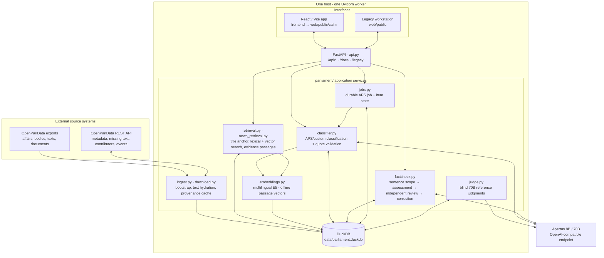

# Technical report — ParlaRadar

A deeper write-up than the README: what we built, how it works, and what the
numbers say.

- **Challenge:** Topic classification for Swiss parliaments with Apertus (OpenParlData.ch, Digital Administration Switzerland use case)
- **Event:** On-site Liebefeld
- **Team:** VectorZero — Mitesh Kumar, Sagnik Das, Aswathy Marottikkal Ramesh, Prabin Sharma Poudel
- **Demo:** `<link to video>`

> **How to read the numbers.** Every figure below is copied from a result file
> committed in this repository (`evaluation/`). Nothing here is an independent
> accuracy benchmark. Section 5 lists what the numbers do **not** show.

## 1. Summary

**Problem.** OpenParlData.ch aggregates 300,000+ affairs from about 90 Swiss
parliaments in German, French, Italian and Romansh, but topic tags are
incompatible between parliaments, and public-sector users such as Digital
Administration Switzerland (DVS) track themes (for example "Digitalisation") that
no official scheme contains. Journalists have a related problem: checking what a
news story says about parliament against the actual record.

**Approach.** ParlaRadar is a local FastAPI application over a DuckDB copy of the
OpenParlData archive. It does two things with Apertus, always tied to source text:

1. **Classification.** Affairs are classified into the 165-topic Année Politique
   Suisse (APS) scheme, or into a user-defined *custom* topic (for example the
   fixed DVS "Digitalisation" scope), without retraining. An embedding shortlist
   reduces the 165 topics to 12 before Apertus chooses; every label must carry a
   quotation that is an exact substring of the source, otherwise the system abstains.
2. **News fact-checking.** A multi-sentence story is split into sentences; each is
   scoped (Swiss parliamentary or not), matched to archive passages, and its
   claims are marked *supported / contradicted / unverified / not factual*.
   Supported and contradicted verdicts require quotations selected from the
   archive and a second, independent model review. No match is never reported as
   "false".

Human review, abstention and verified quotes are design requirements, not
afterthoughts. The default interface is the React app in `frontend/`, served by
FastAPI at `/`; the full existing workstation in `web/` remains available at
`/legacy`.

**Headline results (read with Section 5).**

| Measurement | Result | Source |
|:--|:--|:--|
| Recovery of 42 known DVS/PolitMonitor positives (Apertus 8B, prompt `v3`, 18 Oct 2026) | **20 / 42 = 47.6 %** — below a title-keyword baseline (22 / 42 = 52.4 %) | `evaluation/digitalisation-result.json` |
| Live news-check smoke set (Apertus 70B, 7 stories, 5 languages) | 14 / 14 expected outcomes matched | `evaluation/news-live-regression.json` |
| Automated tests (mocked model) | 74 passing | `python -m unittest discover -s tests` |
| Curia Vista proxy baseline ("Medien und Kommunikation") | 80.9 % recall, 40.9 % tag agreement (reproduced from the slides' cohort) | `evaluation/BENCHMARK.md` |

There is **no precision, F1 or APS accuracy figure** for this system in the
repository: the supplied digitalisation lists contain positives only, and no
affair-level APS ground truth exists. Measuring precision would need a separate,
human-labelled sample that includes negatives (see Section 5).

## 2. Architecture

### Deployed local shape

The demo is a **single-host, single-Uvicorn-worker application**. The local
launcher binds FastAPI to `127.0.0.1:8000`, disables access logging and does not
enable autoreload. `api.py` serves the built React UI at `/` from
`web/public/calm/`, mounts its static files under `/calm/`, retains the original
workstation at `/legacy`, and exposes the OpenAPI document at `/docs`. The React
source lives in `frontend/`; `npm --prefix frontend run build` writes its bundle
to `web/public/calm/`. The legacy application and the React app call the same
FastAPI process and the same DuckDB file.

At runtime, `PARL_DATA_DIR` selects the data directory; otherwise it is
`<repository>/data`. DuckDB is `parliament.duckdb` inside that directory. The
connection layer sets a 1 GB DuckDB memory limit and two DuckDB threads, runs
schema migrations on connect, serializes in-process access with a re-entrant
lock, and takes an OS file lock for each connection. Separate `worker.lock`,
`continuous-classification.lock`, `judge.lock`, and `inference.lock` files
coordinate background and model work across processes. This design targets one
application worker and a local persistent disk; it is not a multi-replica
database design.



### Data ingestion and retrieval

`python -m parliament bootstrap` downloads and imports the affair metadata,
bodies, APS workbook and challenge label files. It creates translated title
units, but **does not imply that all substantive text is already imported**.
`python -m parliament bulk-texts` imports the public text export; documents can
be imported separately. At request time `ensure_affair` and `fetch_content`
hydrate missing affair metadata, texts and (when needed) extracted documents
from the REST API, recording a fetch marker and normalized text units in DuckDB.
Contributor and event provenance is fetched separately, limited to 100 records
per relation, and cached in `settings`.

Embedding is an explicit preparation pipeline, not a separate online vector
database. `export-units` emits source units as JSONL; `embed` uses the pinned
multilingual E5 small model to encode normalized passages (480 tokens with a
64-token overlap) into 384-dimensional vectors and checkpoints batches in
Parquet; `import-embeddings` validates and inserts vectors into DuckDB. The
manifest in `settings.embedding_manifest` identifies model, revision and
preprocessing pipeline. Search computes up to 32 lexical terms against stored
units and, when a compatible embedding manifest and local model are available,
cosine similarity against valid embedded passages using DuckDB list functions.
It takes up to `max(100, 3 × requested_limit)` results from each ranking and
combines them using reciprocal-rank fusion (`1 / (60 + rank)`). Without an
available embedding manifest/model, lexical retrieval still runs and the API
reports semantic search as unavailable.

News retrieval adds a separate grounding path: it first looks for an exact
quoted affair title, then a title contained in the sentence; a narrowly matched
referential continuation can inherit the prior named affair. If no affair is
anchored, the scope pass supplies terms in German, French and Italian to a
whole-word multilingual lexical/vector search. It retains up to eight candidate
affairs, hydrates at most three missing-text candidates, and builds substantive
evidence windows with no more than three passages per affair. Titles are
excluded as claim evidence. Candidate discovery and successful entailment are
separate outcomes: an empty or weak match yields *unverified*, not *false*.

### Durable state model

All server-side state lives in DuckDB; JSON payload columns retain model output
and source snapshots while relational keys support filtering and resumability.

| Tables | Stored state and purpose |
|:--|:--|
| `affairs`, `bodies`, `units`, `fetches` | OpenParlData metadata, parliament bodies, multilingual title/text/document units with hashes and source URLs, and per-affair fetch markers. |
| `topics`, `source_labels`, `embeddings`, `settings` | APS/custom topic definitions and versions; imported source labels; E5 vectors; active embedding manifest, topic-vector cache, and cached provenance. |
| `classifications`, `reviews` | Versioned model predictions keyed by affair/topic/taxonomy/language/content/model/prompt; human review labels, notes, frozen status, and the prediction snapshot reviewed. |
| `jobs`, `job_items` | Resumable batch configuration and one status/result/error/attempt counter per affair-language item. A classification prediction is also cached in `classifications`. |
| `llm_judgments` | Separate 70B reference result tied to the prediction hash, judge version, reference labels, exact-match flag, and TP/FP/FN counts. |
| `fact_checks`, `fact_check_sentences`, `fact_check_translations` | Submitted story and sentence offsets, per-sentence result/evidence hashes, and on-demand cached explanation translations. |

Browser-local state is intentionally distinct: the React app stores recent story
history, selected language/theme, and local UI state in browser `localStorage`.
It does not make those histories shared server records. The legacy review API
stores review rows in DuckDB.

### Components and API boundaries

| Component | Technology | Role |
|:--|:--|:--|
| User interface | React 18, Vite 5, Tailwind 3, Framer Motion; source in `frontend/src/` | The main ParlaRadar news checker, policy-map view, source/author/topic dossiers, language/theme controls, and archive-run visualizations. Static production assets are generated into `web/public/calm/`. |
| FastAPI boundary | `api.py`, Pydantic request/response validation | Serves `/api/status`, `/api/search`, `/api/affairs/*`, `/api/classifications`, `/api/jobs*`, `/api/research/*`, `/api/fact-checks*`, `/api/evaluation*`, and static application routes. `PARL_BACKEND_TOKEN` optionally requires a bearer token; cross-origin writes are rejected. |
| Classification service | `parliament/classifier.py` | Builds versioned cache keys, loads source units, excludes title-only evidence, optionally narrows 165 APS topics to 12 by E5 similarity, asks the selected model for structured topic IDs and source-unit IDs, validates exact substantive quotations in code, then persists the prediction. Models are 8B or 70B; default is 70B, while the automatic 300k APS archive run explicitly uses 8B. |
| Fact-check service | `parliament/factcheck.py`, `news_retrieval.py`, `provenance.py` | Persists a story and sentence offsets; runs one sentence request at a time from the UI. Scope classification, evidence assessment, independent entailment review, correction generation/review, and source-linked APS/custom topics are separate model steps. Supported/contradicted results require validated evidence IDs and source substrings. Explanations translate on demand and cache by target language. |
| Retrieval and embeddings | `retrieval.py`, `news_retrieval.py`, `embeddings.py` | Exact title anchoring and bounded source windows for news; lexical plus E5 nearest-passage retrieval for unanchored search and APS shortlisting. Embedding work can run on CPU, Apple MPS or CUDA; Slurm scripts are provided but cluster execution is unverified. |
| APS archive runner | `jobs.py` in a daemon thread | On application startup, if affairs and APS topics exist, ensures one persistent full-corpus APS job covering up to 300,000 imported affairs using 8B. `jobs`/`job_items` track progress; item errors are retried up to three times for the continuous run. It is resumable and restarts queued work after process restart. The 100-case calibration endpoint measures a separate selected model; it does not change the automatic run's 8B model. |
| Live quality judge | `judge.py` in a daemon thread | Reads completed classification items, hides each prediction, independently labels cached substantive source text with Apertus 70B, validates its exact quotations, and writes reference labels against the prediction hash. The UI's “agreement” scores are agreement with this same-family LLM, not ground-truth accuracy. Inference calls are serialized by a process lock and a file lock. |
| Legacy and optional gateway | `web/public/`; Cloudflare Worker source in `web/src/worker.ts` | `/legacy` retains the original workstation. The Worker has a static-asset route allowlist, API allowlist, optional Cloudflare Access JWT validation and backend bearer-token forwarding; local use does not need it. It is not deployed as part of the supported local demo. |

### Request and background sequences

**News fact-check.** `POST /api/fact-checks` accepts up to 12,000 characters,
language `en/de/fr/it/rm`, up to three custom topic IDs, and the selected 8B/70B
model. It stores the input and sentence offsets in `fact_checks`. The browser
then calls `POST /api/fact-checks/{id}/sentences/{index}` sequentially, allowing
partial results as each sentence finishes. For a sentence, the backend searches
for an affair anchor, asks the model for scope (and search terms if needed),
retrieves bounded evidence, asks for per-claim verdicts by evidence ID, checks
each selected quote in code, and independently reviews supported/contradicted
claims for entailment, entities, dates and procedural status. A contradicted
claim may trigger up to two correction drafts, each source-checked before it is
shown. Cited affairs are enriched with cached provenance and APS topics. Results
are stored in `fact_check_sentences`; requested translations are generated and
stored separately. User history remains in browser storage.

**Archive classification and judging.** FastAPI lifespan starts the classifier
and judge threads. The classifier ensures a persistent APS job exists for the
first 300,000 affair IDs in the local database; each queued `job_item` loads
content and calls the model unless a matching classification cache entry
already exists. Results and status are committed item by item. The judge polls
completed items, assesses them without access to their predictions, and stores
separate judgments. `GET /api/jobs/{id}` joins persisted job progress with topic
counts, co-occurrence edges, four completed labelled affairs, finish-rate
projections, frozen-human-review metrics and LLM-judge agreement. Thus graph and
progress displays read the current saved job; they are not generated UI samples.

### Fact-check flow

1. FastAPI stores the submitted story in DuckDB and returns sentence offsets (up to 40 sentences / 12,000 characters).
2. Apertus assesses political scope with adjacent context and retrieved archive candidates, then extracts multilingual search terms.
3. Retrieval prioritizes exact affair references, fetches missing text for up to three affairs, and keeps up to eight source passages (at most three per affair). Titles are not evidence.
4. The backend selects and validates source quotations; the model returns evidence IDs rather than inventing quotations.
5. A separate review checks entailment, entities, dates, and procedural status. Rejected evidence yields *unverified*.
6. A correction is offered only for a contradicted claim and must pass its own evidence and review checks.
7. The UI shows the claim’s linked record, topic, author, and date when available. Hover previews details; click pins the sentence’s right-hand dossier.

### Runtime and loading

The local page is served by FastAPI; it does not wait for model inference to
render. On 19 October 2026, the running service returned the HTML in 42 ms, the
312 KB JavaScript bundle in 8 ms over loopback, `/api/status` in 84 ms, and the
archive-job summary in 181 ms. Those measurements show a responsive local HTTP
path, not an end-user browser/network timing.

The observed process had been launched with Uvicorn `--reload`; a short CPU
sample showed about 54% CPU in the reload parent and 0% in the API worker. This is
strong evidence that the development file watcher, rather than slow HTML/API
responses, was driving that observed load. The supported `scripts/run_demo.sh`
command does not enable reload. The persistent APS classifier and 70B judge also
consume inference and database resources by design; their current activity varies
with queued work and cache state.

### Target architecture (mandatory)

**What we can honestly state.** ParlaRadar is built so that every external
dependency is a *replaceable endpoint or a one-off download*; none of the three
target architectures has been deployed and tested by us. The demo and all
measurements ran on one laptop (Apple M5, 17 GB RAM) against a hosted Apertus
gateway and the public OpenParlData API.

| Target | Deployable? | How the constraint is met, and what is missing |
|:--|:--|:--|
| **a) On-premise** | **Yes, by configuration** (not tested) | One Python process and one DuckDB file; no database server. Point `APERTUS_BASE_URL` at an on-premise OpenAI-compatible server hosting Apertus (the code needs `response_format` JSON-schema support). Store `data/` on organisation-controlled disks. No Dockerfile or compose file is provided yet. |
| **b) Air-gapped** | **Partially** (not tested) | Possible if (1) the archive is imported, texts bulk-fetched and embeddings built at build time, (2) the embedding model is pre-cached (`HF_HOME`, pinned revision), (3) Apertus is served locally, and (4) live discovery is switched off. At runtime the application otherwise calls the OpenParlData API to fetch missing texts, authors and events; those calls fail and the affected results degrade to *unverified* or abstain. The React UI loads fonts from Google Fonts and must be changed to self-hosted fonts first. |
| **c) Sovereign Swiss cloud** | **Possible, not verified** | Same as (a) on a Swiss cloud VM. The hosted gateway we used has a `.ch` domain, but we did **not** verify its operator, jurisdiction or data residency and make no claim about it. The optional Cloudflare Worker is a non-Swiss provider and must not be used for a sovereign deployment. |

**External dependencies.**

| Dependency | Build time | Runtime | Replaceable by |
|:--|:-:|:-:|:--|
| OpenParlData exports / API | download archive | optional (live discovery, missing texts, authors, events) | pre-imported archive; set live discovery off |
| Multilingual E5 model weights | yes | no (cached) | local model directory |
| Apertus endpoint | no | **yes, mandatory** | any OpenAI-compatible server hosting Apertus (`APERTUS_BASE_URL`) |
| Google Fonts (React UI only) | no | yes (cosmetic) | self-hosted fonts |
| Cloudflare Worker | no | optional | not needed for local use |

**Privacy note for any deployment.** Text a journalist pastes is sent to the
Apertus endpoint and stored in the local DuckDB (`fact_checks` table). On a hosted
endpoint it leaves the machine; use only non-confidential text there.

## 3. Use of Apertus

- **Model:** `apertus-v1-5-8b` and `apertus-v1-5-70b` (selectable per run; default 70B; the judge always uses 70B). Names are those of the Keera gateway.
- **How it is used:** inference with structured output (no fine-tuning, no adapters, no quantisation by us); evaluation (LLM judge); agent-like multi-step chains (scope → assessment → review → correction).
- **Where it runs:** a hosted endpoint (`https://gateway.keera.ch/api/v1`, key read from `.key`). We do not control or know the serving stack. `APERTUS_BASE_URL` can point elsewhere.

**Calls and settings.** `parliament/classifier.py:call_json`: temperature 0,
`max_tokens` 1800, `response_format = json_schema` with `strict: true`; the schema
enumerates the allowed topic IDs and source unit IDs, so the model cannot return
unknown IDs. One repair attempt on invalid output; HTTP retries with backoff. One
inference at a time (file lock) so the gateway is not flooded.

**Tasks and prompts** (all in `parliament/`; versions are part of every cache key):

| Task | Where | Version |
|:--|:--|:--|
| APS / custom-topic classification | `classifier.py` | prompt `named-policy-evidence-v6` |
| Fixed DVS "Digitalisation" scope | `digitalisation.py` | topic `focus:digitalisation:v1` |
| News scope, assessment, review, correction, translation | `factcheck.py` | `archive-factcheck-v4` |
| Blind reference judge | `judge.py` | `blind-archive-judge-v1`, model 70B |
| Custom topic drafting (human approves) | `classifier.py:draft_topic` | — |

**Key design choices that follow from Apertus's limits.**

- A small model is not asked to navigate 165 opaque codes: embeddings shortlist 12 named topics with definitions.
- Evidence is verified by string matching against the source, in code. A quote the model made up cannot become a verified label.
- Source texts are marked as untrusted data in every prompt; the model is told never to judge political positions.
- Neutrality: the classifier receives the affair title and text only, never the author or party.

**To rebuild the setup:** obtain an Apertus 8B/70B endpoint with JSON-schema constrained output, put the key in `.key`, set `APERTUS_BASE_URL` if not using the Keera gateway, and follow Section 6.

## 4. Data

| Data | Source | Use | Licence / status |
|:--|:--|:--|:--|
| Affairs, bodies, texts (≈326k imported affairs per `VALIDATION.md`) | OpenParlData exports and REST API (files.openparldata.ch, api.openparldata.ch) | Archive and retrieval | Parliamentary records published via OpenParlData.ch. The challenge README gives attribution (Parliamentary Services of the Federal Assembly via OpenParlData.ch) but **no explicit licence text** in the copy we have; confirm before redistributing. |
| Curia Vista subject areas, cantonal classifications | Challenge datasets | Source labels stored separately; never treated as APS ground truth | as above |
| APS scheme (8 domains, 22 chapters, 165 topics, DE/FR) | anneepolitique.swiss (`aps_topics.xlsx`) | Target taxonomy | Not stated in the supplied files; keep attribution. |
| PolitMonitor "Digitalisierung" tags (3,433 affairs) | glue / PolitMonitor editorial team via the challenge | Benchmark positives | Editorial labels; positives only, incomplete. |
| DVS list (30 affairs) | digitale-verwaltung-schweiz.ch via the challenge | Benchmark positives | as above |
| Pasted news text | Entered by the user | Fact-checking | Stored in local DuckDB; sent to the Apertus endpoint. |

**Not in the repository:** `data/` (archive, embeddings, caches, results of live
runs), `.key`, `.env`, model weights and large outputs are git-ignored. Only small
frozen result files in `evaluation/` and one sample story in `samples/` are committed.

**Personal information.** Affair records name the elected officials who authored
or co-signed an item, with party and role. This is the public record of their
parliamentary work and is displayed as published; we collected no data from human
subjects and no consent procedure applied. Party affiliation is political
information about identifiable people, so any analysis that groups by party should
be handled with care. We did not run a party- or canton-level bias analysis (see
Section 5). Reviewer annotations are stored locally
and are not part of the repository.

## 5. Limitations

**What the evidence shows, and does not.**

- **The only quantitative benchmark is unfavourable.** On the 42 known positives the 8B model recovered 47.6 %, below the 52.4 % of a title-keyword baseline (DVS subset 43.3 % vs 60.0 %; German 44.0 % vs 56.0 %; French 45.5 % vs 54.5 %; Italian 66.7 % vs 33.3 %). 22 of 42 affairs ended in abstention, 10 had no substantive text, 20 had at least one rejected quote.
- **That benchmark pre-dates the current prompt.** It ran with prompt `named-policy-evidence-v3`; the code is now at `v6` and defaults to the 70B model. The benchmark was **not re-run** after those changes, so the current system's recall on this set is unknown.
- **No precision, F1 or accuracy.** The lists are positives only; unlabelled affairs are not negatives. No affair-level APS gold labels exist. A seven-affair, AI-assisted audit of the 8B APS classifier, documented in `VALIDATION.md`, found 0.00 micro precision and recall; the authors state the classifier "is not ready for unattended use" (`VALIDATION.md`). A verified quotation proves traceability, not that the label is right.
- **No fairness or bias evaluation.** We did not test whether results differ across parties, cantons or languages; the classifier is not given authors or parties, which reduces but does not rule out such effects. No cross-lingual consistency measurement was made on parallel DE/FR/IT texts.
- **Live news check: smoke test only.** 14 / 14 outcomes over 7 short stories, run against the live model but tiny and curated by the team. It is not evidence of accuracy, nor of equal quality across languages, and Romansh quality is unverified.
- **The LLM judge is not ground truth.** It is a second Apertus 70B pass; same-family models can share mistakes. Cases the judge cannot assess (no text, truncated text, abstention) are excluded, which may flatter its scores.
- **Run-time estimates are projections.** The 300,000-affair finish time is a linear extrapolation from a 100-case pilot; cache hits, text availability, latency and retries move it.

**Known failure modes.**

- Missing or short source text: many cantonal affairs carry only a title; the system abstains instead of guessing.
- Retrieval is bounded (one fetched-text pass for up to three affairs, eight passages) and can miss relevant evidence; "unverified" therefore means *not found*, never *false*.
- Scope detection, claim splitting and entailment still rely on the LLM.
- A parliamentary allegation in the archive does not establish real-world truth; proposals are not adopted laws.
- Model output varies between gateway versions; temperature 0 does not guarantee bit-identical answers.
- Autonomous cost: on start-up, if an archive is imported, the backend creates and runs a 300,000-affair classification job (8B) and starts the 70B judge without a user action, and `GET /api/jobs` can create or restart the job. A cancelled job is re-queued. Operators should be aware of the inference cost and the effect on gateway capacity.
- No authentication by default (bind to localhost, or set `PARL_BACKEND_TOKEN`). The optional Worker gateway is untested in production.
- React fact-check history and human-review flags are stored in browser local storage on that device; they are not written to the shared DuckDB review tables.

**Not tested.** On-premise, air-gapped and Swiss-cloud deployments; Romansh retrieval and classification quality; full-corpus vector-search latency; the Slurm scripts on a real cluster; behaviour with more than one API worker; full visual/browser automation coverage. The production UI bundle and live API/inference path were smoke-tested against the local archive.

## 6. Reproducibility

- **Code baseline:** `8c21637` on `main`; the current ParlaRadar UI integration and this report are working-tree changes on that baseline. The benchmark result file was produced earlier (18 Oct 2026) with prompt `v3`.
- **Hardware / OS used by us:** Apple M5, 17 GB RAM, macOS (Darwin, arm64); Python 3.13 in the project virtualenv (3.12+ recommended by the README); Node 26 for the React UI. Embedding on Apple MPS (CPU fallback); optional Slurm job for one A40 GPU.
- **Python dependencies:** `requirements.txt`, `requirements-embeddings.txt` (some ranges, not fully pinned). The embedding model commit is pinned in `data/embedding-revision.json`.
- **Determinism:** sampling uses deterministic hashes (no random seed); the Apertus calls use temperature 0. Model answers still depend on the gateway's model version, so re-runs can differ slightly.

**Steps.**

```bash
python3 -m venv .venv && source .venv/bin/activate
python -m pip install -r requirements-embeddings.txt
echo "<your Apertus key>" > .key && chmod 600 .key
python -m parliament bootstrap                 # import archive + APS catalogue (needs network)
python -m parliament fetch --sample 200        # reproducible sample for embeddings
python -m parliament export-units --sample 200 --output data/prepared/sample.jsonl
python -m parliament embed --input data/prepared/sample.jsonl --output data/embeddings/sample
python -m parliament import-embeddings data/embeddings/sample
bash scripts/run_demo.sh                       # http://127.0.0.1:8000
python -m unittest discover -s tests           # 74 tests, mocked model, no credits
```

**Digitalisation benchmark (needs the archive and Apertus credits):**

```bash
python -m parliament.digital_benchmark prepare   # freezes cohort: 30 DVS + 12 PolitMonitor (manifest hash 8851c72f…)
python -m parliament.digital_benchmark run       # resumable; one language per affair
python -m parliament.digital_benchmark report
python -m parliament.digital_benchmark baseline  # title-keyword and Curia Vista proxy
```

**Live news regression:** `PYTHONPATH=. .venv/bin/python scripts/check_news_live.py`.

**React UI development:** `cd frontend && npm ci && npm run dev` (port 5173; proxies `/api` to port 8000). It uses live backend data and displays backend failures; it does not substitute demo results.

**What we did and did not re-run.** Automated checks and one live 70B fact-check
smoke test were run during the ParlaRadar UI integration. The benchmark and
regression figures above are copied from committed result files and were not
re-run here; a full benchmark spends Apertus credits and is not a substitute for
a human-labelled evaluation.

## License

Creative Commons Attribution 4.0 (CC-BY-4.0). All HackApertus projects are open-sourced.
(The repository's source code is separately under the MIT licence, see `LICENSE`.)

## References

- Challenge presentation: https://hackapertus-topic-classification-5c233f.gitlab.io/
- OpenParlData exports: https://files.openparldata.ch/exports/ · challenge datasets: https://files.openparldata.ch/hackapertus/ · API: https://api.openparldata.ch/documentation
- Année Politique Suisse thematic scheme: https://anneepolitique.swiss/de/themen/
- Digital Public Services Switzerland, political affairs list: https://www.digitale-verwaltung-schweiz.ch/aktuelles/politische-geschaefte
- Multilingual E5 small (embeddings) and Apertus (Swiss AI) provide the retrieval and classification models.
- DuckDB: https://duckdb.org
- In-repository evidence: `evaluation/BENCHMARK.md`, `evaluation/digitalisation-result.json`, `evaluation/news-live-regression.json`, `VALIDATION.md`, `PRODUCT.md`
